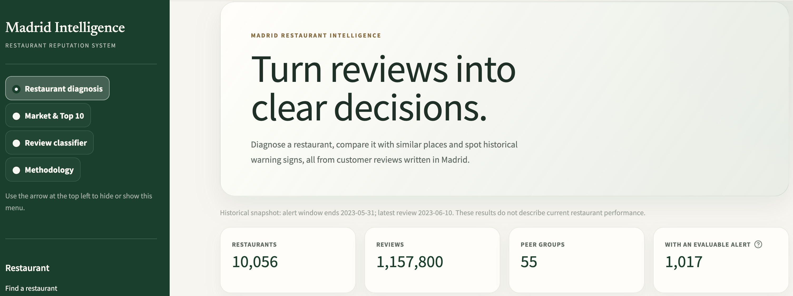

# Madrid Restaurant Intelligence

[](https://doi.org/10.5281/zenodo.14622324)

Turn 1.16 million TripAdvisor reviews into clear decisions for Madrid restaurants: a reputation diagnosis for each restaurant, comparisons with similar places, historical warning signs, and a bilingual (Spanish/English) review classifier that explains every prediction.



> **Historical snapshot.** The data end on 10 June 2023. Results describe past reputation, not current restaurant performance.

## What the app does

| View | What you get |
|---|---|
| **Restaurant diagnosis** | Rating, positive and negative review shares, a decision summary, review themes (food, service, waiting time…) and a ranked action plan with evidence and a way to measure improvement. |
| **Peer comparison** | The restaurant against others with the same cuisine and price range: rank, rating gap and negative-share gap. |
| **Historical alerts** | Whether the restaurant's reputation deteriorated between two six-month periods, with a severity level and the evidence behind it. |
| **Market & Top 10** | Leaders in each cuisine and price group, including a rating adjusted for review volume so small samples do not dominate. |
| **Review classifier** | Classifies any review as Negative, Neutral or Positive and shows the exact contribution of each word. |
| **Methodology** | How each result is calculated, including the alert backtest. |

## Key results

**Data.** 1,157,800 Spanish and English reviews of 10,056 Madrid restaurants, November 2002 to June 2023, after cleaning and deduplication.

**Sentiment classifier** (TF-IDF + LinearSVC). Evaluated once on 110,912 reviews from 996 restaurants never used in development:

| Model | Macro F1 | Negative recall | Balanced accuracy | Accuracy |
|---|---|---|---|---|
| Always predict "Positive" (baseline, validation set) | 0.287 | 0.000 | 0.333 | 0.757 |
| **TF-IDF + LinearSVC (final)** | **0.808** | **0.879** | **0.816** | **0.905** |

By language: macro F1 0.809 in Spanish and 0.793 in English. The Neutral class (3-star reviews) is the hardest, with F1 0.60, because many 3-star reviews mix praise and complaints.

**Competitive groups.** 55 cuisine and price groups (at least 30 restaurants and 1,000 reviews each) cover 96.7% of comparable restaurants and 98.0% of their reviews.

**Historical alerts, validated.** The alert rule was backtested on 20 earlier pairs of six-month windows (2013–2022, 28,660 evaluations). Six months after an alert, the rating was still at least 0.40 below its earlier level in:

| Alert level | Decline persisted | Lift vs. no alert |
|---|---|---|
| No alert (base rate) | 16.1% | 1.0× |
| Watch | 41.2% | 2.6× |
| High alert | 60.3% | 3.7× |
| Critical alert | 65.1% | 4.0× |

The pattern holds in every period, including COVID-19. Alerts based on 5–9 reviews per window persisted as often as those with 10 or more. High and Critical alerts are not reliably different in persistence (65.1% vs 60.3%, z ≈ 1.6), so Critical describes a larger drop rather than a longer-lasting one.

## Data

The project uses the Madrid subset of the **TripAdvisor Restaurant Reviews** dataset, collected in 2023 by researchers at Universidad de Oviedo and Universidade da Coruña and published on Zenodo under the [Creative Commons Attribution 4.0](https://creativecommons.org/licenses/by/4.0/) license.

> Pérez-Núñez, P., Blanco, E., Bolón-Canedo, V., & Remeseiro, B. (2025). *TripAdvisor Restaurant Reviews* (Version 2.0.0) [Data set]. Zenodo. https://doi.org/10.5281/zenodo.14622324

**Changes made to the original data** (as the license requires stating them): only restaurants in Madrid and reviews labeled Spanish or English are kept; duplicate rows are removed; invalid restaurant ratings (`0` and `-10`) are treated as missing; ratings are rescaled from 10–50 to 1–5; price ranges are renamed Budget, Mid-range and Premium; user information and image and page URLs are not used. Notebook 1 documents every step.

## Project structure

```
.
├── 01_data_cleaning_EN.ipynb                 # Cleaning, validation (pandera) and export
├── 02_exploratory_data_analysis_EN.ipynb     # EDA, diagnosis, peer groups, alerts, backtest, split
├── 03_modeling_and_productization_EN.ipynb   # Model selection, final test, MLflow, review themes
├── streamlit_app.py                          # App entry point
├── app/
│   ├── ui.py                 # Visual design and chart styling
│   ├── benchmarking.py       # Peer groups, rankings, market explorer
│   ├── insights.py           # Decision summary and action plan
│   ├── aspects.py            # Bilingual keyword themes
│   ├── inference.py          # Model loading and prediction
│   ├── explainability.py     # Exact per-word explanations
│   └── api.py                # FastAPI endpoints
├── data/                     # Prepared data and project_config.json
├── artifacts/                # Saved model, metrics and MLflow store
├── .streamlit/config.toml    # App theme
├── requirements.txt          # App dependencies
└── requirements-modeling.txt # Notebooks and API dependencies
```

## Getting started

Create an environment (Python 3.11 or newer) and install the dependencies:

```bash
python -m venv .venv
source .venv/bin/activate          # Windows: .venv\Scripts\activate
pip install -r requirements-modeling.txt
```

To reproduce the results, download `Madrid.zip` from the [dataset page](https://doi.org/10.5281/zenodo.14622324), unzip it and place `reviews.pkl` and `items.pkl` in `data/` (`users.pkl` is not needed). Then run the notebooks in order from the project root: 01, then 02, then 03. Notebook 3 retrains the model, which takes a few minutes.

### Run the app

```bash
streamlit run streamlit_app.py
```

The app opens at `http://localhost:8501`. It only needs the prepared files, not the raw data:

- `data/restaurant_diagnostics.parquet`, `benchmark_membership.parquet`, `benchmark_groups.parquet`
- `data/restaurant_review_aspects_EN.parquet` and `alert_backtest_summary.parquet`
- `data/project_config.json`
- `artifacts/models/sentiment_tfidf_linear_svc.joblib`

### Run the API

```bash
uvicorn app.api:app --reload
```

Interactive documentation is available at `http://127.0.0.1:8000/docs`.

```bash
curl -X POST http://127.0.0.1:8000/api/v1/sentiment \
     -H "Content-Type: application/json" \
     -d '{"review_text": "La comida estaba buena, pero el servicio fue muy lento."}'
```

| Endpoint | Purpose |
|---|---|
| `GET /health` | Model status and classes |
| `POST /api/v1/sentiment` | Label and decision scores for one review |
| `POST /api/v1/sentiment/explain` | Exact contribution of each word to the prediction |

## Methodology

**Target.** Sentiment comes from the star rating: 1–2 stars are Negative, 3 Neutral, 4–5 Positive. The classifier uses only the review title and text; ratings, price, cuisine and dates are excluded to avoid leakage.

**Honest evaluation.** Train, validation and test sets are split by restaurant (`StratifiedGroupKFold`), so no restaurant appears in more than one set. TF-IDF is fitted on training data only, hyperparameters are tuned on validation only, and the test set is used once. Class weights handle the imbalance (75% Positive). MLflow records every run, and the final model is registered with a `champion` alias.

**Explanations.** The model is linear, so each word's contribution is its TF-IDF weight multiplied by the model coefficient. Contributions plus the intercept add up exactly to the model score; no approximation such as LIME is needed.

**Diagnosis and peers.** A full diagnosis requires at least 30 reviews. Peer references exclude the restaurant itself and give each restaurant equal weight. The adjusted rating adds 30 group-average reviews to every restaurant (a Bayesian average).

**Alerts.** Two consecutive six-month windows (June–November 2022 and December 2022–May 2023), at least five reviews in each. Watch, High and Critical require both a rating decline (−0.40, −0.80, −1.00) and a rise in negative share (+10, +20, +30 points). All windows and thresholds are stored in `data/project_config.json`, which the app reads.

## Limitations

- Sentiment labels come from star ratings, not from annotated emotions or verified causes.
- Review themes are keyword matches: they do not detect negation ("not bad"), and a theme mentioned in negative reviews is an association, not a proven cause.
- Alerts are historical and descriptive; they do not forecast future reputation.
- Decision scores are not calibrated probabilities.
- Performance on reviews that mix languages, or in languages other than Spanish and English, has not been evaluated.

## Tech stack

Python · pandas · scikit-learn · pandera · MLflow · Streamlit · Plotly · FastAPI

## License

- **Code:** see [LICENSE](LICENSE).
- **Data:** the TripAdvisor Restaurant Reviews dataset by Pérez-Núñez, Blanco, Bolón-Canedo and Remeseiro is licensed under [CC BY 4.0](https://creativecommons.org/licenses/by/4.0/). The prepared files in `data/` are derived from it; keep this attribution if you reuse them. Review texts were written by TripAdvisor users.
